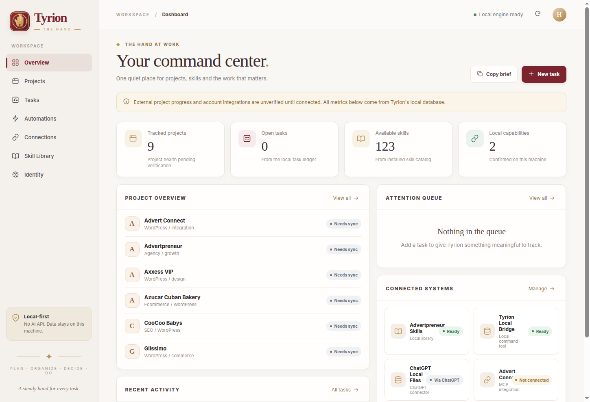
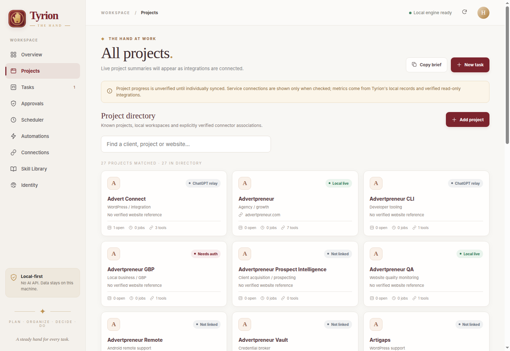
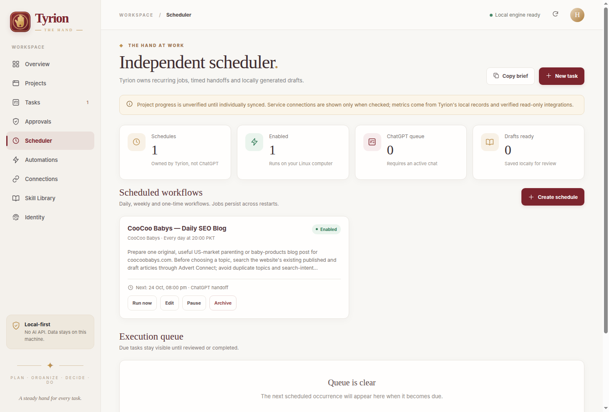
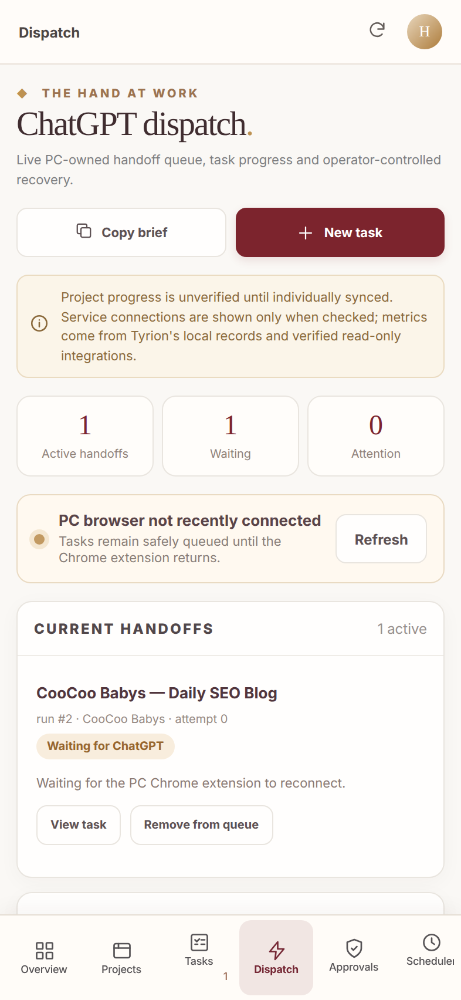

<p align="center">
  
</p>
<h1 align="center">Tyrion — The Hand</h1>
<p align="center"><strong>A local-first command center for Advertpreneur projects, tasks, research, and authorized AI handoffs.</strong></p>
<p align="center">Linux desktop · Chrome companion · Android companion · Python MCP bridge</p>

> **Repository status (October 26, 2026):** Private development project. The PC dashboard and local integrations are operational; some external/ChatGPT/Android workflows require separate authorization or validation. This repository contains source code and documentation, **not** the running PC database or any connected account credentials.

## At a glance

| Area | What it does |
| --- | --- |
| Local control center | Projects, shared tasks, notes, priorities, approvals, activity, and connection health in one lightweight dashboard. |
| Durable scheduler | Daily/weekly/one-off scheduled work with local queueing, draft review, and explicit execution modes. |
| ChatGPT / MCP | Dedicated Python MCP interface to inspect the original records, triage work, and write verified status back to the same task. |
| Dispatch | Persistent SQLite handoff queue with deduplication, stale claim detection, and operator-controlled recovery. |
| Browser Companion | Chrome MV3 popup/side panel for task handoffs and a per-conversation queue of additional instructions. |
| Android Companion | Native Android shell displaying the PC interface over authenticated, private Tailscale connectivity. |
| Knowledge | Local semantic search with isolated Ollama EmbeddingGemma and optional explicitly indexed media. |
| Skills and research | Skill routing, permitted static analysis, current public-discussion research, and separately sourced SEO keyword evidence. |

## Screenshots

| Desktop overview | Project hub |
| --- | --- |
|  |  |

| Independent scheduler | Android dispatch (PC-served) |
| --- | --- |
|  |  |

The hand-seal identity, soft light UI, project controls, and mobile layout are part of the bundled application, not mockups. Screenshots show local development snapshots; availability and connection status vary by installation.

## Quick start — Linux desktop

**Requirements:** Linux (developed on Linux Mint), Python 3.12 (standard library backend), curl, and either GTK 3 + WebKit2GTK 4.1, Chrome/Chromium, or Firefox for the interface. Git is required only to clone the repository. Optional integrations have separate requirements.

```bash
git clone https://github.com/haseebgb92/Tyrion-The-Hand.git
cd Tyrion-The-Hand
chmod +x launch.sh stop.sh
./launch.sh
```

The desktop launcher opens a GTK/WebKitGTK window when available; otherwise it falls back to an installed browser. Open the local dashboard directly at **http://127.0.0.1:17877/**. Stop a manually started instance with `./stop.sh`. Your existing machine may also provide `tyrion-hand.service`, `tyrion-companion.service`, and `tyrion-companion-events.service`; those systemd user units are **machine-installed services**, not bundled installers in this repository.

```bash
python3 -m tyrion.bridge snapshot
python3 -m tyrion.bridge tasks
python3 -m tyrion.bridge schedules
python3 -m tyrion.bridge knowledge-status
python3 -m tyrion.bridge knowledge-search "What is blocking a project?"
```

Run the local MCP stdio endpoint with `./bin/tyrion-mcp` (equivalent to `python3 -m tyrion.bridge mcp`) in an authorized MCP host. **A repository clone does not automatically configure a public ChatGPT plugin, remote tunnel, browser extension, or API connection.** Keep MCP exposure behind a private, authenticated integration.

### Desktop menu integration (optional)

The included `Tyrion-The-Hand.desktop` is an example for the original development machine and contains absolute paths. Before installing it into `~/.local/share/applications/`, change its `Exec` and `Icon` fields to match your checkout. Do not use the checked-in absolute paths unchanged on another computer.

## Components

### PC dashboard and work tracking

- `tyrion/server.py`, `tyrion/core.py`, `tyrion/project_hub.py`: localhost HTTP interface, SQLite records, project directory, task updates, operator approvals, and audit trail.
- `static/`: responsive light interface and the original gold/burgundy seal icon.
- `tyrion/change_feed.py`, `tyrion/realtime.py`: persisted change events and same-origin browser event stream; local UI may refresh without manual page reload.
- `tyrion/workflow_scheduler.py`: timezone-aware schedules, independent due queue, Ollama draft generation or ChatGPT handoffs, review workflow, and catch-up limits.
- `tyrion/companion_dispatch.py`, `tyrion/companion_events.py`: durable handoff claims, browser status, conservative timeouts, and local event notifications.
- `tyrion/bridge.py`, `tyrion/mcp_events.py`: allowlisted CLI/MCP actions and event-subscription support. Remote subscription success is environment-specific and must be verified.

### Browser Companion · Chrome MV3 v1.2.0

1. Open `chrome://extensions`, enable **Developer mode**, and **Load unpacked** the `browser-extension/` folder.
2. In Tyrion’s **Connections** screen, obtain the local browser pairing key and pair the extension.
3. Use the popup/side panel to review handoffs, reopen the original Tyrion task, or queue instructions against a specific ChatGPT conversation.

The extension has a restricted localhost bridge and a ChatGPT content script for an **opt-in one-shot** handoff. Automatic tab opening/submission may fail if Chrome or ChatGPT changes; no response-reading, credential extraction, or claim of task completion is built into that click. Real task progress must be written back to Tyrion. See [Browser Companion guide](browser-extension/README.md) and [Steering queue](STEERING_QUEUE.md).

### Android Companion · native Android shell

The `android-companion/` Android Gradle project uses Java 17, Android SDK 35 for compilation, minimum Android 8.0 (API 26), target API 34. It connects to the **same PC database**, not a second synchronized copy.

- Requires the PC service and its authenticated companion relay, Tailscale on both devices, and a **private** Tailscale Serve endpoint (no public Funnel for the mobile relay).
- Pair by time-limited, single-use code; device credentials can be revoked from the PC.
- The server-served mobile UI includes projects, tasks, and dispatch; mobile changes are subject to the same PC permissions.
- Offline edits, Firebase push notifications, and a signed production Android release are not provided. A development debug APK is not committed.

Build from `android-companion/` with `./gradlew :app:assembleDebug` after installing the Android SDK. For pairing, build/test limits, and service checks, see [Android guide](android-companion/README.md).

### Knowledge and skill engines

- `tyrion/knowledge.py`: approved task/project/docs indexing; derived local embedding cache (not the source of truth).
- Isolated Ollama on `127.0.0.1:11435` is **optional**. Text retrieval uses the configured EmbeddingGemma 270M model; selected-image/video-frame embeddings can use EmbeddingGemma 740M. Models are **not included** in Git.
- Skills are routed from the local Advertpreneur catalog when available. Ponytail supplies reuse-first development guidance; REA is limited to allowlisted inert JS inspection; Scrapling belongs to a separately configured crawler; Last30Days gathers bounded public discussions.
- `tyrion/content_research.py`: Instagram, LinkedIn, and CooCoo Babys research packets with attribution. GSC rows and Ubersuggest ideas remain distinct from verified Google Ads Planner metrics. E92 importing is supported in code, but the connector’s successful end-to-end retrieval is **not yet verified**.

See [Knowledge engine](KNOWLEDGE-ENGINE.md), [Knowledge/ChatGPT contract](CHATGPT-KNOWLEDGE-CONTRACT.md), and [Research status](CONTENT_RESEARCH_STATUS_2026-10-26.md).

## Architecture

```text
Chrome MV3 ────────┐
                   │ local paired HTTP / WebSocket
Desktop UI ────────┼──> Tyrion PC (Python + SQLite) ───> task + schedule queues
                   │          │                   ├──> source-labelled research
Android + Tailscale┘          ├──> optional local Ollama embeddings/drafts
                              └──> allowlisted MCP / approved integrations
ChatGPT MCP host <───────────> authorized private MCP tunnel or stdio bridge
```

The PC is the authoritative store. Browser, Android, and ChatGPT are clients/handoffs, not independent agents with unlimited permissions. External WordPress, Shopify, social, GBP, and search-console integrations have **different levels of access and freshness**; an imported record never proves a current live-site change.

## Security and data handling

- HTTP UI is loopback-only (`127.0.0.1:17877`); protected writes use a volatile session token, origin checks, and constrained routes. Mobile relay requires separate authenticated private networking.
- Approval-controlled actions are distinct from drafts, suggestions, and status reads. No generic shell execution via the HTTP or MCP interface.
- **Excluded from Git:** `data/` (SQLite databases, client/task state, passwords/tokens, draft packets, logs, and local screenshots), Android local SDK paths/build output, keystores, `.env` files, caches, and compiled artifacts.
- Never copy `data/*.token`, private TLS keys, GitHub credentials, OAuth sessions, export files, or a personal vault into an issue or commit.
- ChatGPT/MCP interactions can send selected task text to the model provider. Local EmbeddingGemma alone does not upload the local vector index.
- No automatic publishing, spending, client-site editing, or email sending is enabled merely by installing the repository. Review and explicit approval are required for consequential external actions.

For backups, securely copy the **local** `data/` directory outside Git; do not share it publicly. No private runtime files are necessary for code review.

## Testing

```bash
python3 -m unittest discover -s tests -q
node --test browser-extension/tests/*.test.cjs
node --check browser-extension/background.js
node --check browser-extension/popup.js
cd android-companion && ./gradlew :app:lintDebug :app:assembleDebug
```

**Last checked 2026-10-26:** 92 Python tests and 9 Chrome extension tests passed; JavaScript syntax checks passed. Android build/lint previously passed in the original developer environment but was **not rerun as part of this GitHub import**. A unit test does not prove that a particular cloud connector, Chrome handoff, or physical Android device is presently connected.

## Repository map

| Location | Purpose |
| --- | --- |
| `tyrion/` | Python dashboard, SQLite domain logic, integrations, scheduler, MCP, knowledge, and companion transport. |
| `static/` | Desktop/web interface assets. |
| `browser-extension/` | Chrome Manifest V3 companion and tests. |
| `android-companion/` | Native Android application source and Gradle wrapper. |
| `plugin/` | Private MCP/plugin branding metadata and setup skill. |
| `clients/` | Local knowledge client adapters. |
| `tests/` | Python regression tests. |
| `scripts/` | Development diagnostics and screenshot helpers. |
| `docs/screenshots/` | Curated UI images safe to track separately from runtime `data/`. |

## More documentation

- [Shared work and task progress](CHATGPT-SHARED-WORK.md) · [Events and subscription limitations](TYRION_CHATGPT_WORK_EVENTS.md)
- [Advert Connect read-only adapter](ADVERT_CONNECT_READ_ONLY.md) · [Project history verification](PROJECT_HISTORY_AUDIT_2026-10-26.md)
- [Research integration evidence](CONTENT_RESEARCH_STATUS_2026-10-26.md) · [Skill/plugin refresh](PLUGIN_TOOL_REFRESH_2026-10-26.md)
- [Original development notes](docs/DEVELOPMENT_HISTORY.md) — chronological historical record; old connection claims may be superseded.

## Current limits and roadmap

**Verified locally:** dashboard, persistent records, independent scheduling/queue behavior, constrained MCP/CLI, Python and extension regression tests, and local knowledge integration. **Requires independent installation/verification:** production-grade packaging, Tailscale Android physical-device pairing, external event/webhook delivery to ChatGPT, hosted tunnel operation, and real connected-account permissions. E92 Google Ads metrics retrieval is blocked by connector errors; do not claim a verified volume.

Potential next releases: portable Linux installer and user-service setup, signed Android build, cross-platform desktop package, connection health self-tests, and integration-specific end-to-end checks.

---

Built for the Advertpreneur ecosystem. **Private development source; no open-source license has been granted.**